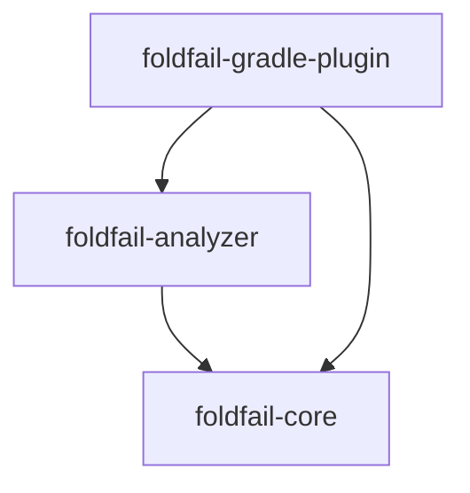

# FoldFail Architecture

FoldFail is structured as a modular multi-project Gradle build consisting of three primary modules:
1. `foldfail-core`: Core data models, engine, and reporting writers.
2. `foldfail-analyzer`: Manifest analyzer, XML layout parser & analyzers, and Kotlin/Compose source analyzers.
3. `foldfail-gradle-plugin`: Gradle plugin extension, task implementation, manifest/layout/Kotlin discovery, and verification lifecycle integration.

---

## Module Diagram

---

## Core Architecture (`foldfail-core`)

### Finding Model & Rule Abstraction
- **`FoldFailFinding`**: Immutable data model representing a rule violation (`ruleId`, `title`, `message`, `severity`, `confidence`, `file`, `evidence`, `remediation`).
- **`Severity`**: `INFO`, `WARNING`, `ERROR`.
- **`Confidence`**: `LOW`, `MEDIUM`, `HIGH`.
- **`FoldFailRule`**: Interface defining rule contract (`id`, `description`, `analyze(context)`).

### Analysis Context & Engine
- **`FoldFailContext`**: Encapsulates project root (`Path`), discovered manifests (`List<Path>`), layout resources (`List<LayoutResource>`), and Kotlin source files (`List<Path>`).
- **`FoldFailEngine`**: Executes registered rules independently, catches rule runtime exceptions to prevent silent failures, and sorts findings deterministically.

---

## Analyzer Architecture (`foldfail-analyzer`)

### Manifest Analysis
- Uses secure `DocumentBuilderFactory` settings (disabling doctype declarations and external DTDs/schemas) to parse `AndroidManifest.xml` files.
- Inspects `<activity>` elements for explicit `screenOrientation` (FF001) and aspect-ratio constraints (FF002).

### XML Layout Analysis (`LayoutParser`)
- **`LayoutParser`**: Secure DOM parser extracting view element tag names, widths, heights, weights, scroll container flags, and attribute maps.
- **Rules (FF003–FF006)**: Analyzes root width constraints, inner large dimensions, structural complexity vs. missing adaptive variants, and absolute positioning (`AbsoluteLayout`, `layout_x`/`layout_y`).

### Compose Analysis (`ComposeSourceParser`)
- **`ComposeSourceParser`**: Parses `.kt` source files to identify `@Composable` functions, modifier calls (`width`, `height`, `size`, `requiredWidth`, `requiredHeight`, `requiredSize`), and adaptive cues (`WindowSizeClass`, `BoxWithConstraints`, conditional sizing branches).
- **Rules (FF007–FF010)**: Analyzes hardcoded dp dimensions, restrictive required sizes, missing adaptive layout handling, and restrictive modifier chains.

---

## Gradle Plugin & Task Execution (`foldfail-gradle-plugin`)

### Discovery & Lifecycle Integration
- **Discovery**: Walks project source roots to discover manifests (`AndroidManifest.xml`), layout XML files (`res/layout*`), and Kotlin source files (`.kt`), while explicitly excluding build outputs (`build`, `.gradle`, `.git`, `.idea`, `generated`).
- **Verification Lifecycle**: Hooks lazily into `./gradlew check` during `afterEvaluate` when `enabled && runOnCheck`.
- **Configuration Cache**: Utilizes modern Gradle lazy properties (`DirectoryProperty`, `RegularFileProperty`, `ListProperty`, `Property`, `InputDirectory`) for full configuration-cache compatibility.

### Reporting & Quality Gates
- **Reporting**: Generates multi-format reports (`CONSOLE`, `JSON`, `HTML`, `SARIF 2.1.0`).
- **Baseline**: `FoldFailBaseline` computes stable signatures (`ruleId:file:evidence`) to track and filter known tech debt.
- **Quality Gates**: Enforces thresholds (`NEVER`, `ERROR`, `WARNING`, `NEW`), failing the Gradle build when exceeded after reports are fully written to disk.
