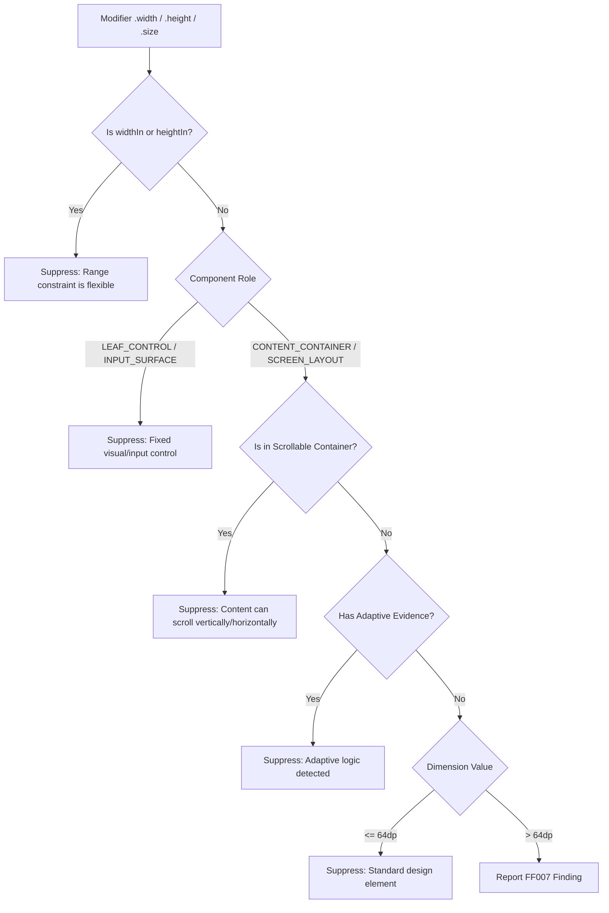

# Compose Rule Decision Models (FF007 – FF010)

## Executive Summary

This document specifies the exact decision models, evidence criteria, classification tables, and suppression rules for Jetpack Compose static analysis rules (FF007, FF008, FF009, and FF010). 

The decision logic eliminates false positives observed in real-world applications (e.g. `OtpTextField` leaf controls and `BannerAdminCard` list items) while preserving high precision when identifying genuine responsive UI defects.

---

## 1. Decision Matrix Overview

| Rule | Targeted Defect | High Confidence Criteria | Suppressed / Ignored Scenarios |
| :--- | :--- | :--- | :--- |
| **FF007** | Fixed single-axis dp dimension on unadapted container | Fixed height/width $>120\text{dp}$ on non-scroll screen container without adaptive cues | Leaf controls, input controls, items in scroll containers (`LazyColumn`, `LazyRow`), `dp \le 64` |
| **FF008** | Restrictive `requiredSize` overriding parent bounds | `requiredWidth`/`requiredHeight` $>48\text{dp}$ on content panel or screen container | Small controls ($\le 48\text{dp}$), icons, touch targets, badges |
| **FF009** | Screen container lacking responsive branching | Screen/Dashboard container without detected window size class or adaptive grid | Composables with `GridCells.Adaptive`, pane scaffolds, parameter-driven adaptive state, leaf controls |
| **FF010** | Dual-axis boundary lock (width + height fixed) | Fixed width AND height on non-leaf container | Input controls (`OtpTextField`), icons, avatars, buttons, spacers |

---

## 2. FF007 — Fixed Dimension Modifier

### Decision Tree & Logic


### Supported & Unsupported Code Examples

#### ❌ Reported Defect (Valid Finding)
```kotlin
@Composable
fun CategoryOverviewPanel() {
    // Fixed height 200dp on non-scrollable content panel
    Column(modifier = Modifier.fillMaxWidth().height(200.dp)) {
        Text("Title")
        Text("Description text that may expand...")
    }
}
```

#### ✅ Suppressed Pattern (Not a Defect)
```kotlin
@Composable
fun BannerAdminCard() {
    // Height 150dp specified for card item inside a LazyColumn list
    Card(modifier = Modifier.fillMaxWidth().height(150.dp)) {
        Text("Banner")
    }
}

@Composable
fun UserAvatar() {
    // Small visual element (<= 64dp)
    Image(modifier = Modifier.size(56.dp), painter = painterResource(id = R.drawable.avatar), contentDescription = null)
}
```

---

## 3. FF008 — Restrictive Required Size

### Sizing & Severity Matrix

| Dimension Value | Component Role | Assigned Severity | Assigned Confidence |
| :--- | :--- | :--- | :--- |
| $\le 48\text{dp}$ | `LEAF_CONTROL` / `INPUT_SURFACE` | `INFO` | `LOW` |
| $> 48\text{dp}$ | `CONTENT_CONTAINER` / `SCREEN_LAYOUT` | `WARNING` | `HIGH` |
| Any | `UNKNOWN` | `WARNING` | `MEDIUM` |

#### ❌ Reported Defect (Valid Finding)
```kotlin
@Composable
fun MainFormContainer() {
    // Overrides parent layout constraints on a major screen section
    Column(modifier = Modifier.requiredWidth(360.dp).requiredHeight(600.dp)) {
        Text("Form Content")
    }
}
```

#### ✅ Suppressed / Info Pattern
```kotlin
@Composable
fun CustomBadgeIcon() {
    // Overriding touch target / icon minimum constraints intentionally
    Icon(modifier = Modifier.requiredSize(24.dp), imageVector = Icons.Default.Star, contentDescription = null)
}
```

---

## 4. FF009 — Missing Adaptive Layout Handling

### Comprehensive Adaptive Evidence Set
A composable is recognized as **Adaptive** (`hasAdaptiveEvidence = true`) if it uses any of the following constructs:

1. **Window Size Classes**: `WindowSizeClass`, `calculateWindowSizeClass()`, `WindowWidthSizeClass`, `WindowHeightSizeClass`.
2. **Adaptive Layout Containers**: `BoxWithConstraints`, `GridCells.Adaptive(...)`, `FlowRow`, `FlowColumn`.
3. **Pane Scaffolds & Adaptive Navigation**: `ListDetailPaneScaffold`, `SupportingPaneScaffold`, `ThreePaneScaffold`, `NavigationSuiteScaffold`, `NavigationRail`.
4. **Configuration & Features**: `LocalConfiguration.current`, `FoldingFeature`, `DisplayFeature`, `rememberAdaptiveInfo()`.
5. **Parameter-Driven State**: Function parameter matching `isExpanded`, `windowSize`, `paneState`, `displayMode`.

#### ❌ Reported Defect (Valid Finding)
```kotlin
@Composable
fun AdminNotificationsScreen() {
    // Complex screen layout without any adaptive branching or flexible grid
    Column(modifier = Modifier.fillMaxSize().padding(16.dp)) {
        Text("Header")
        Row(modifier = Modifier.width(400.dp)) {
            Text("Notification Item")
        }
    }
}
```

#### ✅ Suppressed Pattern (Not a Defect)
```kotlin
@Composable
fun ProductGridScreen() {
    // Uses GridCells.Adaptive to automatically reflow columns based on screen width
    LazyVerticalGrid(columns = GridCells.Adaptive(minSize = 160.dp)) {
        items(products) { ProductCard(it) }
    }
}
```

---

## 5. FF010 — Restrictive Modifier Chain Combination

### OTP Input Field Regression Model
Dual-axis modifier lock (`width(X.dp).height(Y.dp)` or `size(Z.dp)`) must **never** flag leaf input surfaces, controls, or visual indicators.

#### Regression Fixture: `OtpTextField`
```kotlin
@Composable
fun OtpTextField(
    otpText: String,
    onOtpTextChange: (String, Boolean) -> Unit
) {
    BasicTextField(
        value = otpText,
        onValueChange = { ... },
        decorationBox = {
            Row(horizontalArrangement = Arrangement.Center) {
                repeat(4) { index ->
                    // FIXED SIZING ON LEAF OTP CHARACTER CELL: MUST BE SUPPRESSED
                    Box(
                        modifier = Modifier
                            .width(16.dp)
                            .height(52.dp)
                            .border(1.dp, Color.Gray)
                    )
                }
            }
        }
    )
}
```

#### ❌ Reported Defect (Valid Finding)
```kotlin
@Composable
fun FixedContentCard() {
    // Content panel locked on both axes without scroll or input role
    Column(modifier = Modifier.width(320.dp).height(480.dp)) {
        Text("Card Content")
    }
}
```

#### ✅ Suppressed Pattern (Not a Defect)
```kotlin
@Composable
fun OtpCell() {
    // Input surface leaf control locked to fixed character cell dimension
    Box(modifier = Modifier.width(40.dp).height(52.dp))
}

@Composable
fun AppLogo() {
    // Visual branding icon (leaf control)
    Image(modifier = Modifier.size(64.dp), painter = painterResource(R.drawable.logo), contentDescription = null)
}
```
