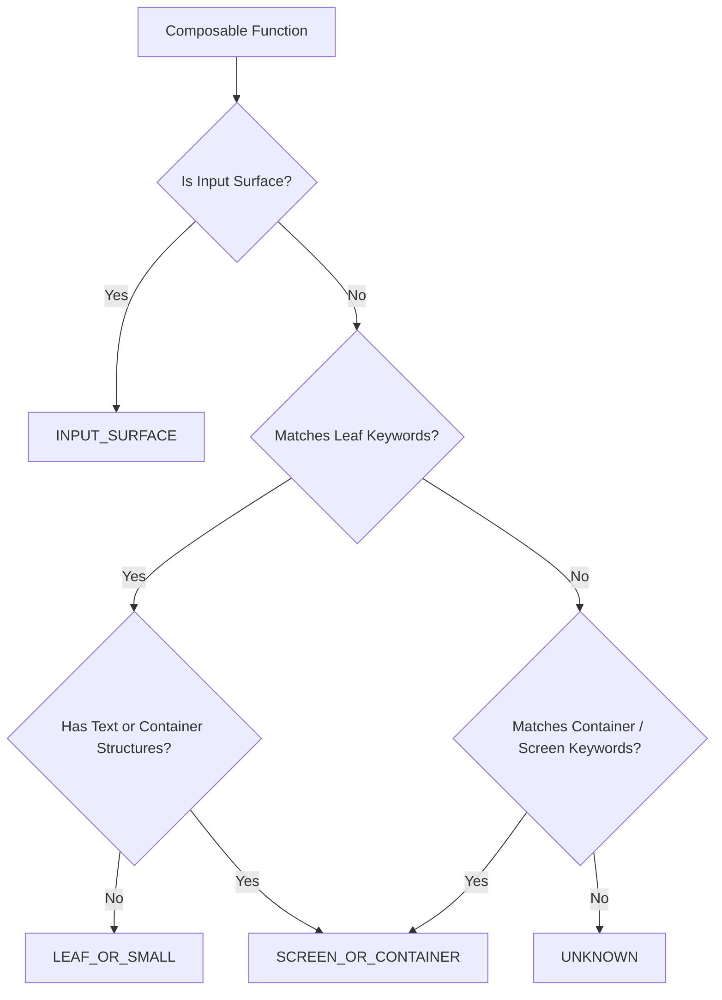

# Semantic Soundness Review — FF007 & Component-Role Inference Policy

## Executive Summary

This document defines ViewLint's unified semantic reasoning policy for rule `FF007` (Hardcoded Dimension Analysis) and component-role classification.

It reconciles historical discrepancies and establishes a single, defensible policy governing scroll mitigation, leaf component exemptions, content-bearing card analysis, and unknown component fallback handling.

---

## 1. Unified Policy for Rule `FF007` & Scroll Mitigation

ViewLint enforces five strict semantic principles for analyzing hardcoded dimensions in Compose:

### Principle 1: Scrollable Ancestor Non-Exemption
> **A scrollable ancestor such as `LazyColumn` or `LazyRow` does NOT automatically make a fixed-height child card safe.**

- *Rationale*: A `LazyColumn` enables scrolling *between* list items. However, if a child list item (`Card` or `Column`) specifies a hardcoded height (e.g. `150.dp`) and contains dynamic text, text overflowing `150.dp` will clip or truncate inside the card. The outer `LazyColumn` does not make the card's internal layout expandable.
- *ViewLint Policy*: Fixed-height content-bearing cards inside scrollable ancestors remain eligible for `FF007` analysis.

### Principle 2: Direct Internal Scroll Mitigation
> **An internally scrollable content container mitigates clipping risk when the scroll behavior applies directly to the constrained content.**

- *Rationale*: If a container specifies a fixed height (e.g. `250.dp`) AND includes `.verticalScroll(rememberScrollState())` in its modifier chain or is an inherently scrollable primitive (e.g. `LazyColumn(modifier = Modifier.height(300.dp))`), internal content can scroll freely within the fixed height without clipping.
- *ViewLint Policy*: Hardcoded dimensions on directly scrollable modifier chains or inherently scrollable container primitives are exempted from `FF007`.

### Principle 3: Content-Bearing Cards & Panels
> **Fixed-size content-bearing cards, sheets, panels, and forms MUST remain eligible for analysis.**

- *Rationale*: Non-scrollable containers holding variable/dynamic text or child layout structures represent primary sources of layout breakage on variable-sized windows.
- *ViewLint Policy*: Non-scrollable cards, forms, and sheets with fixed dimensions > 48dp (or > 64dp) and text content generate `FF007` (single axis) or `FF010` (dual axis) warnings.

### Principle 4: Leaf Controls & Input Surface Exemptions
> **Leaf graphics, icons, avatars, and intentionally fixed-size input controls are NOT treated as content-bearing containers without supporting evidence.**

- *Rationale*: Icons (`24.dp`), touch target avatars (`40.dp`), chips (`48.dp`), and PIN/OTP character input cells (`16.dp` x `52.dp`) require fixed dimensions by visual design.
- *ViewLint Policy*: Pure leaf graphics without text and recognized input surface components are exempted unless text content or nested container structures are detected.

### Principle 5: Explicit Unknown Component Fallback
> **Unknown component roles MUST remain explicitly `UNKNOWN` rather than being guessed.**

- *Rationale*: Guessing that an unclassified composable (`CustomWidget()`) is a "Screen Container" inflates false positive rates, while guessing it is a "Leaf" misses real defects.
- *ViewLint Policy*: When keywords and primitives do not match, `comp.role` is set to `ComponentRole.UNKNOWN`. It is evaluated on direct dimension evidence with `Confidence.MEDIUM`.

---

## 2. Component-Role Decision Logic

---

## 3. Rule Deduplication & Finding Identity (`FF007` vs `FF010`)

When a single unscrollable modifier chain specifies fixed dimensions on **both axes** (e.g. `Modifier.width(300.dp).height(400.dp)` or `Modifier.size(250.dp)`):

- **`FF010`** triggers to flag the dual-axis boundary lock.
- **`FF007`** is **suppressed** for that modifier chain to eliminate duplicate finding noise.

This guarantees 1:1 finding identity per root cause.
