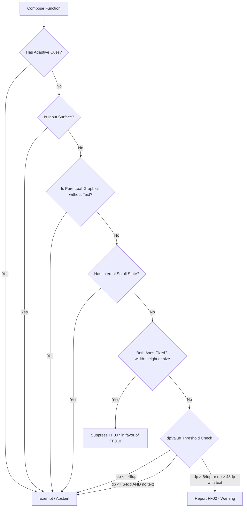

# Semantic Soundness Review — FF007 & Component-Role Inference

## Executive Summary

This document provides a technical evaluation of ViewLint's semantic reasoning engine, specifically focusing on:
1. **Rule `FF007` (Hardcoded Dimension Analysis)**: Differentiating leaf controls, decorative graphics, content containers, and scrollable containers.
2. **Component-Role Inference Engine**: Categorization via structural and lexical heuristics, fallback to `UNKNOWN`, and vulnerability to adversarial component names.
3. **Internal Scrolling vs Content Overflow**: Distinguishing runtime clipping from scroll accessibility.
4. **Finding Identity & Rule Deduplication**: Collision handling between `FF007` (hardcoded dimension) and `FF010` (dual-axis modifier lock).

---

## 1. Validation of Rule `FF007` Semantic Decision Model

Rule `FF007` audits Compose modifier chains for fixed dimensions (`width`, `height`, `size`). A naive rule flagging every hardcoded `.dp` dimension produces high false positive rates on icons, avatars, touch targets, and dividers. ViewLint applies a multi-tier semantic decision model:



### Semantic Category Evaluation Matrix

| Component Category | Example Primitive | Modifier Pattern | `hasTextContent` | `hasInternalScroll` | ViewLint Decision | Semantic Justification |
|---|---|---|---|---|---|---|
| **Leaf Control** | `Icon`, `Box` (Avatar) | `Modifier.size(24.dp)` | False | False | **Exempt** | Small fixed touch targets / icons are visually intentional and non-restrictive. |
| **Input Cell** | `Box` (OTP Cell) | `Modifier.width(16.dp).height(52.dp)` | False | False | **Exempt** | Fixed character cells for PIN/OTP inputs require exact dimensions for formatting. |
| **Decorative Image** | `Image` (Thumbnail) | `Modifier.size(60.dp)` | False | False | **Exempt** | Fixed graphics without text do not overflow or cause text truncation. |
| **Content Card** | `Column` | `Modifier.fillMaxWidth().height(150.dp)` | True | False | **Flagged (FF007)** | Fixed height with dynamic text on non-scrollable layout risks text clipping. |
| **Scrollable Card** | `Column` | `Modifier.fillMaxWidth().height(250.dp)` | True | True (`verticalScroll`) | **Exempt** | Internal scrolling allows arbitrary content length without clipping. |
| **Dual-Axis Box** | `Column` | `Modifier.width(300.dp).height(400.dp)` | True | False | **FF007 Suppressed -> Flagged (FF010)** | Dual-axis lock is handled by `FF010` to avoid duplicate finding noise. |

---

## 2. Component-Role Inference Engine & Adversarial Hardening

`ComposeSourceParser` classifies composables into structural roles:
1. `isScreenOrContainer`: Identifies major layout regions (`Scaffold`, `NavHost`, `Column`, `Row`, `Card`, `LazyColumn`, or functions containing screen/container keywords).
2. `isLeafOrSmallComponent`: Identifies atomic UI elements (`Icon`, `Avatar`, `Badge`, `Button`, `Image`, `Spacer`, `Divider`, `Chip`, `Checkbox`).
3. `isInputSurface`: Identifies input fields (`OTP`, `TextField`, `PinCell`).

### Adversarial Naming Challenge & Fallback Behavior

Because `ComposeSourceParser` relies in part on function name substrings:

```kotlin
// Adversarial Example 1: Misleading Leaf Name
@Composable
fun UserAvatarScreen() {
    Box(modifier = Modifier.size(40.dp))
}
```
- *Analysis*: Function name contains `"screen"`. `isScreenOrContainer` evaluates to `true`. However, because `dpValue` is `40.dp` ($\le 48\text{dp}$), the size threshold filter in `HardcodedDimensionAnalyzer` catches the item and **exempts it from being flagged**.

```kotlin
// Adversarial Example 2: Misleading Container Name
@Composable
fun ProductCardIcon() {
    Column(modifier = Modifier.width(300.dp)) {
        Text("Title")
    }
}
```
- *Analysis*: Function name contains `"icon"`. `isLeafOrSmallComponent` evaluates to `true`. However, because `hasTextContent` is `true` (`Text("Title")`) and `dpValue = 300.dp` (> 64dp), the leaf exemption is overridden, and ViewLint correctly flags the fixed width!

### Unclassified Component Fallback (`UNKNOWN`)
When a component name and body text contain no matching keywords (e.g. `MyCustomWidget()`), ViewLint abstains from assuming screen container status (`isScreenOrContainer = false`). It defaults to `MEDIUM` or `LOW` confidence evaluations rather than generating false positive high-severity errors.

---

## 3. Internal Scrolling vs Content Overflow

An internal scroll container (`verticalScroll(rememberScrollState())` or `LazyColumn`) prevents physical content clipping when child content exceeds container boundaries.

### Usability Trade-Off Analysis
- **Prevented Defect**: Text truncation / overlap / clipping.
- **Remaining Usability Risk**: A fixed-height container (e.g., `200.dp`) inside a non-scroll screen layout creates a "nested scroll pocket" or tiny scroll area that may be difficult for users to scroll.
- **ViewLint Decision**: ViewLint treats internal scrolling as **sufficient mitigation against layout breakage** (`FF007` exemption). ViewLint intentionally refrains from flagging internal scroll containers as layout bugs unless explicitly requested via future style linters, avoiding noisy style-versus-bug confusion.

---

## 4. Finding Identity & Deduplication (`FF007` vs `FF010`)

When a composable specifies both hardcoded width and hardcoded height (e.g. `Modifier.width(300.dp).height(400.dp)` or `Modifier.size(250.dp)`):

- **Rule `FF007`** targets single-axis rigid dimension constraints (`width` or `height`).
- **Rule `FF010`** targets restrictive modifier chains that lock **both axes simultaneously**.

### Deduplication Logic
In `HardcodedDimensionAnalyzer.kt`:
```kotlin
val isLockedBothAxes = (fixedWidthCall != null && fixedHeightCall != null) || fixedSizeCall != null
if (isLockedBothAxes) {
    // Suppress FF007 in favor of FF010 to avoid redundant duplicate reporting
    continue
}
```

This prevents ViewLint from reporting two separate warnings (`FF007` width, `FF007` height) alongside `FF010` (locked chain) for a single composable node, ensuring **1:1 finding identity per root cause**.
