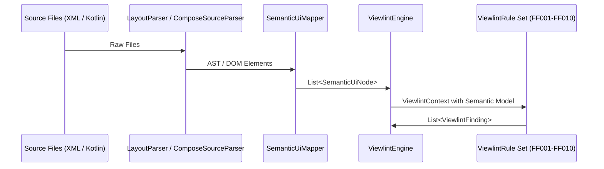

# Normalized Semantic UI Model Specification

## Executive Summary

To eliminate rule-by-rule parsing duplication, inconsistent heuristic classifications, and isolation bugs across XML and Compose analyzers, Viewlint introduces a **Normalized Semantic UI Model**.

Currently, each rule independently parses raw source texts or XML trees, guessing whether a node is a container, screen, or leaf element using ad-hoc regex matches or string comparisons.

The **Semantic UI Model** establishes a unified intermediate representation (IR) produced during the parsing phase and consumed deterministically by all static analysis rules (FF001–FF010).

---

## 1. Model Definition

```kotlin
package com.viewlint.analyzer.model

import java.nio.file.Path

/**
 * High-level component role inferred from source structure, parameters, and naming patterns.
 */
enum class ComponentRole {
    LEAF_CONTROL,        // Icons, badges, dividers, spacers, chips, progress indicators
    DECORATIVE_ELEMENT,  // Background graphics, static illustrations, visual accents
    INPUT_SURFACE,       // OtpTextField, TextField, Checkbox, Switch, RadioButton, Sliders
    CONTENT_CONTAINER,   // Cards, sheets, dialogs, item rows/columns, bounded surface panels
    SCREEN_LAYOUT,       // Full screens, dashboards, forms, scaffolds, main pages
    NAVIGATION_COMPONENT,// NavRail, NavigationBar, BottomNavigation, Drawer
    UNKNOWN              // Fallback when evidence is insufficient
}

/**
 * Constraint type applied on width or height axes.
 */
enum class ConstraintType {
    EXACT_DP,            // e.g. width(150.dp), layout_width="150dp"
    REQUIRED_EXACT_DP,   // e.g. requiredWidth(150.dp)
    RANGE_DP,            // e.g. widthIn(min = 100.dp, max = 300.dp)
    FLEXIBLE_FILL,       // e.g. fillMaxWidth(), match_parent
    FLEXIBLE_WRAP,       // e.g. wrapContentWidth(), wrap_content
    WEIGHT,              // e.g. weight(1f), layout_weight="1"
    UNCONSTRAINED        // No explicit modifier/attribute
}

/**
 * Axis-specific dimension constraint.
 */
data class DimensionConstraint(
    val type: ConstraintType,
    val valueDp: Double? = null,
    val minDp: Double? = null,
    val maxDp: Double? = null,
    val isRequired: Boolean = false,
    val rawExpression: String
)

/**
 * Normalized representation of a UI Node across XML and Compose.
 */
data class SemanticUiNode(
    val id: String,
    val name: String,
    val sourceFile: Path,
    val startLine: Int,
    val role: ComponentRole,
    val widthConstraint: DimensionConstraint,
    val heightConstraint: DimensionConstraint,
    val hasScrollableParent: Boolean = false,
    val isScrollContainer: Boolean = false,
    val hasAdaptiveEvidence: Boolean = false,
    val adaptiveEvidenceDetails: List<String> = emptyList(),
    val rawModifierChain: List<String> = emptyList(),
    val children: List<SemanticUiNode> = emptyList(),
    val confidence: SemanticConfidence = SemanticConfidence.HIGH
)

enum class SemanticConfidence {
    HIGH,    // Direct structural evidence
    MEDIUM,  // Heuristic pattern match
    LOW      // Inferred fallback
}
```

---

## 2. Parsing Boundaries & Data Flow



### 1. Source Parsing Layer
- `LayoutParser`: Converts XML files into raw `LayoutNode` DOM trees.
- `ComposeSourceParser`: Parses Kotlin source files, extracting composable definitions, modifier chains, and body constructs.

### 2. Semantic Mapping Layer (`SemanticUiMapper`)
- Transforms raw XML `LayoutNode` and Compose `ParsedComposable` objects into canonical `SemanticUiNode` representations.
- Infers `ComponentRole` using explicit rules:
  - **Input Control Heuristic**: Function or class name containing `TextField`, `Input`, `Otp`, `Selector`, `Picker`, `Checkbox`, `Switch`, `RadioButton` $\rightarrow$ `INPUT_SURFACE`.
  - **Leaf Control Heuristic**: Name containing `Icon`, `Avatar`, `Badge`, `Divider`, `Spacer`, `Chip`, `Dot`, `Logo`, `Thumbnail`, or `dp <= 48.0` $\rightarrow$ `LEAF_CONTROL`.
  - **Screen Layout Heuristic**: Name containing `Screen`, `Dashboard`, `Scaffold`, `Page` or containing `NavHost` / `Scaffold` call $\rightarrow$ `SCREEN_LAYOUT`.
  - **Container Heuristic**: `Card`, `Sheet`, `Dialog`, `Box`, `Row`, `Column`, `Surface` $\rightarrow$ `CONTENT_CONTAINER`.
  - Fallback: `UNKNOWN`.

### 3. Adaptive Evidence Identification
A node is marked with `hasAdaptiveEvidence = true` if any of the following are detected:
- Compose: `WindowSizeClass`, `calculateWindowSizeClass()`, `BoxWithConstraints`, `GridCells.Adaptive`, `ListDetailPaneScaffold`, `SupportingPaneScaffold`, `NavigationSuiteScaffold`, `NavigationRail`, `FlowRow`, `FlowColumn`, `LocalConfiguration.current`, `rememberAdaptiveInfo()`.
- XML: Presence of resource qualifier directories (`layout-sw600dp`, `layout-w600dp`, `layout-land`).

---

## 3. How Rules Consume the Model

With the Semantic UI Model, rules no longer perform independent parsing or ad-hoc keyword matching:

- **FF007 (Hardcoded Dimensions)**:
  - Inspects nodes with `widthConstraint.type == EXACT_DP` or `heightConstraint.type == EXACT_DP`.
  - Automatically **bypasses** nodes where `role == LEAF_CONTROL` or `role == INPUT_SURFACE` or `hasScrollableParent == true` or `hasAdaptiveEvidence == true`.
  - Eliminates false positives on `OtpTextField`, `BannerAdminCard` in list, and standard icon controls!

- **FF008 (Required Dimensions)**:
  - Inspects nodes with `widthConstraint.isRequired == true` or `heightConstraint.isRequired == true`.
  - Adjusts severity based on `role`: `WARNING` for `CONTENT_CONTAINER` / `SCREEN_LAYOUT`; `INFO` for `LEAF_CONTROL`.

- **FF009 (Missing Adaptive Handling)**:
  - Targets nodes where `role == SCREEN_LAYOUT` or `role == CONTENT_CONTAINER`.
  - Checks if `hasAdaptiveEvidence == false`.
  - Respects `GridCells.Adaptive` and pane scaffolds automatically!

- **FF010 (Restrictive Modifier Chains)**:
  - Checks nodes where BOTH `widthConstraint` AND `heightConstraint` are `EXACT_DP` or `REQUIRED_EXACT_DP`.
  - Automatically **bypasses** nodes where `role == INPUT_SURFACE` or `role == LEAF_CONTROL`.

---

## 4. Performance & Compatibility Implications

1. **Performance Overhead**: Zero measurable penalty. Source parsing happens once per run. The mapping step converts light in-memory data classes into `SemanticUiNode` objects in linear time $O(N)$.
2. **Backward Compatibility**: Fully preserved. `ViewlintContext` can hold the optional semantic model while maintaining existing `manifests`, `layouts`, and `kotlinSources` lists.
3. **Migration Strategy**:
   - Phase A: Implement `SemanticUiModel` and `SemanticUiMapper` in `viewlint-analyzer`.
   - Phase B: Refactor Compose rules (FF007–FF010) to consume `SemanticUiNode`.
   - Phase C: Refactor XML rules (FF003–FF006) to consume `SemanticUiNode`.
   - Phase D: Add comprehensive unit tests covering input surfaces (OTP fields), adaptive grids, and scroll parent context.
