# Viewlint Static Analysis & Reliability Audit (v0.9.0)

## Executive Summary

This document presents the Phase 1 comprehensive architecture and static-analysis reliability audit of **Viewlint** (release candidate v0.9.0). Viewlint is designed to detect Android adaptive UI risks across Android Manifests, XML layout resources, and Jetpack Compose source files.

Our analysis evaluated the core engine, AST/source parsing techniques, report generation, Gradle integration, and rule implementations (FF001–FF010). While Viewlint establishes a clean modular architecture and Gradle configuration-cache support, the analyzer currently suffers from significant static analysis limitations:
1. **RegEx/Text-based heuristic parsing** for Jetpack Compose rather than semantic PSI (Program Structure Interface) parsing or structured AST resolution.
2. **Inflexible component role heuristics** based on substring keyword matching (e.g. `OtpTextField` failing leaf control detection due to missing `"field"` or `"input"` keywords).
3. **Missing parent-child context aware analysis** (e.g., treating standard fixed-height list/grid items in `LazyColumn` or `LazyVerticalGrid` as unadapted layout regions).
4. **Incomplete adaptive cue detection** (e.g., ignoring standard Compose adaptive APIs like `GridCells.Adaptive`, parameter-driven responsive state, and parent scaffold adaptation).
5. **Raw Manifest vs. Merged Manifest discrepancies** (e.g. relying on raw XML `<uses-sdk>` tags instead of resolved build configuration for `targetSdkVersion`).

Below is the detailed architectural map and rule-by-rule breakdown.

---

## 1. System Architecture Map

```mermaid
graph TD
    subgraph Gradle Integration [viewlint-gradle-plugin]
        Plugin[ViewlintPlugin]
        Task[ViewlintTask]
        Ext[ViewlintExtension]
    end

    subgraph Core Engine & Reporting [viewlint-core]
        Engine[ViewlintEngine]
        Context[ViewlintContext]
        Finding[ViewlintFinding]
        Baseline[ViewlintBaseline]
        RepHtml[HtmlReportWriter]
        RepJson[JsonReportWriter]
        RepSarif[SarifReportWriter]
    end

    subgraph Analysis Layer [viewlint-analyzer]
        Registry[ViewlintRuleRegistry]
        XmlParser[LayoutParser DOM]
        CmpParser[ComposeSourceParser Pattern Matcher]
        
        subgraph Manifest Rules
            FF001[FF001: OrientationRestrictionAnalyzer]
            FF002[FF002: AspectRatioAnalyzer]
        end

        subgraph XML Rules
            FF003[FF003: FixedRootWidthAnalyzer]
            FF004[FF004: FixedDimensionAnalyzer]
            FF005[FF005: MissingAdaptiveVariantsAnalyzer]
            FF006[FF006: LayoutPositioningAnalyzer]
        end

        subgraph Compose Rules
            FF007[FF007: HardcodedDimensionAnalyzer]
            FF008[FF008: RequiredSizeAnalyzer]
            FF009[FF009: MissingAdaptiveHandlingAnalyzer]
            FF010[FF010: RestrictiveModifierChainsAnalyzer]
        end
    end

    Task --> Engine
    Task --> Context
    Engine --> Registry
    Registry --> FF001 & FF002 & FF003 & FF004 & FF005 & FF006 & FF007 & FF008 & FF009 & FF010
    FF001 & FF002 --> XmlParser
    FF003 & FF004 & FF005 & FF006 --> XmlParser
    FF007 & FF008 & FF009 & FF010 --> CmpParser
    Engine --> Finding
    Task --> RepHtml & RepJson & RepSarif & Baseline
```



---

## 2. Rule-by-Rule Assessment (FF001 – FF010)

### FF001 — Activity Orientation Lock
- **What it detects**: Explicit `android:screenOrientation` attribute on `<activity>` tags in `AndroidManifest.xml`.
- **Source types analyzed**: `AndroidManifest.xml` files discovered in project source directories.
- **Node Identification**: DOM XML traversal of `<activity>` nodes.
- **Syntax patterns supported**: `android:screenOrientation="portrait|landscape|reversePortrait|reverseLandscape|sensorPortrait|sensorLandscape|locked"`.
- **Contextual Evidence**: Attribute name and string value.
- **Severity**: `WARNING`
- **Confidence**: `MEDIUM`
- **Priority**: `HIGH`
- **Causes of False Positives**:
  - Activities that explicitly handle orientation changes or opt into size-handling configurations.
  - Camera/Scanner activities or specific hardware-bound utility activities where orientation lock is functionally required.
- **Causes of False Negatives**:
  - Orientation locked programmatically via `activity.requestedOrientation = ActivityInfo.SCREEN_ORIENTATION_PORTRAIT` in Kotlin/Java.
  - Orientation restrictions declared in library manifests merged during build.
  - Activity aliases (`<activity-alias>`).
- **Untested scenarios**: Programmatic orientation changes, activity-alias declarations, merged manifest configurations.
- **Explainability**: High. Directly quotes `android:screenOrientation`.

### FF002 — Activity Aspect Ratio Constraint
- **What it detects**: `android:maxAspectRatio` or `android:minAspectRatio` when effective `resizeableActivity` is `false`.
- **Source types analyzed**: `AndroidManifest.xml`.
- **Node Identification**: DOM XML inspection of `<uses-sdk>`, `<application>`, and `<activity>` elements.
- **Syntax patterns supported**: `android:maxAspectRatio`, `android:minAspectRatio`, `android:resizeableActivity`.
- **Contextual Evidence**: Aspect ratio values and targetSdkVersion fallback logic.
- **Severity**: `WARNING`
- **Confidence**: `MEDIUM`
- **Priority**: `HIGH`
- **Causes of False Positives**:
  - Apps targeting API 24+ where `resizeableActivity` defaults to `true`, but `targetSdkVersion` is omitted in `AndroidManifest.xml` (specified in `build.gradle.kts` instead), causing Viewlint to fallback to `targetSdkVersion = null` -> `resizeableActivity = false`.
- **Causes of False Negatives**:
  - Programmatically applied bounds via `setAspectRatio`.
  - Manifest overlays from build flavors.
- **Untested scenarios**: `targetSdkVersion` defined in Gradle script rather than Manifest XML.
- **Explainability**: High, provided `targetSdkVersion` is accurately resolved.

### FF003 — Fixed Root Width
- **What it detects**: Root view specifying hardcoded dp width without alternative qualified layout variants (`-sw600dp`, `-w600dp`, `-land`, etc.).
- **Source types analyzed**: XML layout files (`res/layout*`).
- **Node Identification**: Root DOM node `layout_width`.
- **Syntax patterns supported**: `android:layout_width="<number>dp"`.
- **Contextual Evidence**: Presence of matching layout names in resource qualifier folders.
- **Severity**: `WARNING`
- **Confidence**: `MEDIUM`
- **Priority**: `MEDIUM`
- **Causes of False Positives**:
  - Dialog layouts, popup windows, or fixed-width side panels designed to be non-fullscreen modal components.
- **Causes of False Negatives**:
  - Hardcoded root height causing vertical truncation (`layout_height="600dp"`).
  - Dimension resources (e.g. `layout_width="@dimen/dialog_width"`).
- **Untested scenarios**: Dimension resource references, dialog XML layout roots.
- **Explainability**: Good.

### FF004 — Fixed Large Inner Bounds
- **What it detects**: Non-scroll view with both `layout_width` AND `layout_height` set to hardcoded dp values $\ge 300\text{dp}$.
- **Source types analyzed**: XML layout files (`res/layout*`).
- **Node Identification**: Inner DOM element hierarchy traversal.
- **Syntax patterns supported**: `android:layout_width` and `android:layout_height` in dp.
- **Contextual Evidence**: Element tag name checking for scroll container names (`ScrollView`, `RecyclerView`, etc.).
- **Severity**: `INFO`
- **Confidence**: `LOW`
- **Priority**: `LOW`
- **Causes of False Positives**:
  - Decorative header illustrations or map/chart surfaces with intentional large aspect-constrained dimensions.
- **Causes of False Negatives**:
  - A fixed height of `250dp` on a content panel containing dynamic multi-line text (which clips text on small screens, but is $< 300\text{dp}$).
  - Fixed dimensions on one axis only (e.g., `layout_height="400dp"` without fixed width).
  - Use of `@dimen/...` references.
- **Untested scenarios**: Single-axis fixed large bounds, dimension resource pointers.
- **Explainability**: Moderate.

### FF005 — Complex Layout Lacks Adaptive Variants
- **What it detects**: XML layout files with high DOM node count (> 15 nodes) lacking alternative qualified resource variants.
- **Source types analyzed**: XML layout files.
- **Node Identification**: Recursive DOM tree node counting.
- **Syntax patterns supported**: Entire XML tree node structure.
- **Contextual Evidence**: Layout resource file directory qualifiers.
- **Severity**: `INFO`
- **Confidence**: `LOW`
- **Priority**: `LOW`
- **Causes of False Positives**:
  - Highly optimized, percentage-based `ConstraintLayout` instances that adapt fluidly across all screen sizes without needing separate XML files.
- **Causes of False Negatives**:
  - Flat layout hierarchies (e.g. 10 nodes) with rigid absolute nested dimensions.
- **Untested scenarios**: Percentage/Constraint-driven responsive single-file layouts.
- **Explainability**: Weak. Node count is an arbitrary heuristic.

### FF006 — Absolute Positioning
- **What it detects**: Use of `<AbsoluteLayout>` or `android:layout_x` / `android:layout_y`.
- **Source types analyzed**: XML layout files.
- **Node Identification**: DOM node tag name and attribute search.
- **Syntax patterns supported**: `<AbsoluteLayout>`, `android:layout_x`, `android:layout_y`.
- **Contextual Evidence**: Node tag and attribute keys.
- **Severity**: `WARNING`
- **Confidence**: `HIGH` (`AbsoluteLayout`) / `MEDIUM` (`layout_x`/`y`)
- **Priority**: `HIGH`
- **Causes of False Positives**: Rare.
- **Causes of False Negatives**: Massive hardcoded margins (e.g., `layout_marginLeft="450dp"`) acting as pseudo-absolute positioning.
- **Untested scenarios**: Excessive hardcoded margin offsets.
- **Explainability**: Excellent.

### FF007 — Hardcoded Composable Dimensions
- **What it detects**: Composable modifier calls using `.width(...)`, `.height(...)`, or `.size(...)` with hardcoded dp values without adaptive cues.
- **Source types analyzed**: Kotlin source files (`.kt`).
- **Node Identification**: Regex scanning for `@Composable` functions and regex matching on `.modifierCall(...)`.
- **Syntax patterns supported**: `.width(150.dp)`, `.height(150.dp)`, `.size(150.dp)`.
- **Contextual Evidence**: `comp.isLeafOrSmallComponent` and `comp.isScreenOrContainer` boolean flags based on function name and text keywords; `comp.hasAdaptiveCues`.
- **Severity**: `WARNING`
- **Confidence**: `HIGH` (if `dp > 120` or container) / `MEDIUM` (if `dp > 64`) / `LOW`.
- **Priority**: `HIGH` / `MEDIUM`
- **Causes of False Positives**:
  - **List/Grid Item Cards**: `BannerAdminCard`, `ProductItem`, `AdminMenuCard`, etc., specified with `height(150.dp)` when placed inside a scrollable `LazyColumn` or `LazyRow`. Fixed height in a scroll container is standard design practice, not a defect!
  - Multi-line modifier definitions (regex fails to parse parameters correctly or misses dp values split across lines).
  - Composable parameters passing explicit heights for specific visual elements.
- **Causes of False Negatives**:
  - `width(100.dp)` on a text container containing dynamic localized strings.
  - Modifier extensions e.g. `Modifier.cardSize()`.
- **Untested scenarios**: Composables inside `LazyColumn` / `LazyRow`, multi-line modifier declarations, modifier variables.
- **Explainability**: Moderate. Often flags valid list items as defects.

### FF008 — Restrictive Required Size
- **What it detects**: `requiredWidth`, `requiredHeight`, `requiredSize` modifiers overriding parent constraints.
- **Source types analyzed**: Kotlin source files (`.kt`).
- **Node Identification**: Regex search for `requiredSize`, `requiredWidth`, `requiredHeight`.
- **Syntax patterns supported**: `.requiredWidth(300.dp)`, `.requiredSize(24.dp)`.
- **Contextual Evidence**: Component role heuristic (`isScreenOrContainer` vs `isLeafOrSmallComponent`).
- **Severity**: `WARNING` (for containers) / `INFO` (for small components).
- **Confidence**: `HIGH` (for containers) / `LOW` (for small components).
- **Priority**: `HIGH` / `LOW`.
- **Causes of False Positives**:
  - Intentional constraint overrides (e.g., custom badge indicators, specialized drawing canvases).
- **Causes of False Negatives**:
  - Multi-line `requiredSize` modifier calls missed by single-line regex.
- **Untested scenarios**: Multi-line required size modifier calls.
- **Explainability**: Good.

### FF009 — Missing Adaptive Layout Handling
- **What it detects**: Screen-level composables or major containers lacking detectable adaptive cues (`WindowSizeClass`, `BoxWithConstraints`, etc.).
- **Source types analyzed**: Kotlin source files (`.kt`).
- **Node Identification**: Regex block extractor for `@Composable` functions matching `screenOrContainerKeywords`.
- **Syntax patterns supported**: Text keyword search for `windowsizeclass`, `boxwithconstraints`, `calculatewindowsizeclass`, `config.screenwidthdp`, etc.
- **Contextual Evidence**: Keyword presence in composable body text.
- **Severity**: `INFO`
- **Confidence**: `LOW`
- **Priority**: `LOW`
- **Causes of False Positives**:
  - Screens using `LazyVerticalGrid(columns = GridCells.Adaptive(minSize = 160.dp))` (not listed in `hasAdaptiveCues`!).
  - Screen composables accepting adaptive state via parameters (e.g. `isExpanded: Boolean`, `scaffoldState`).
  - Screen composables nested within an adaptive parent (e.g., `NavigationSuiteScaffold`).
- **Causes of False Negatives**:
  - Screens named without keywords like `"Screen"` or `"Dashboard"` (e.g., `AdminNotifications`).
- **Untested scenarios**: `GridCells.Adaptive`, parameter-driven responsive state, parent scaffold delegation.
- **Explainability**: Weak. Frequently misses modern Compose adaptive constructs like `GridCells.Adaptive`.

### FF010 — Restrictive Modifier Chains
- **What it detects**: Combining fixed width and fixed height or fixed size modifiers on non-leaf components.
- **Source types analyzed**: Kotlin source files (`.kt`).
- **Node Identification**: Modifier call array pattern matching.
- **Syntax patterns supported**: `.width(X.dp).height(Y.dp)` or `.size(Z.dp)`.
- **Contextual Evidence**: `comp.isLeafOrSmallComponent` boolean flag.
- **Severity**: `WARNING`
- **Confidence**: `HIGH` (if container) / `MEDIUM`.
- **Priority**: `HIGH` / `MEDIUM`.
- **Causes of False Positives**:
  - `OtpTextField` using `width(16.dp).height(52.dp)` or `width(40.dp).height(52.dp)` — leaf input controls with intentionally fixed character cell bounds! Keyword list missed `"field"`, `"otp"`, `"input"`, `"textfield"`.
- **Causes of False Negatives**:
  - Modifiers chained across variables or helper functions.
- **Untested scenarios**: Input fields, OTP controls, multi-line modifier chains.
- **Explainability**: Good concept, but flawed component role heuristics cause high false positives on leaf inputs.

---

## 3. Duplicated Logic & Cross-Rule Inconsistencies

1. **Duplicated Component Role Classification**: `ComposeSourceParser` attempts to classify composables using two hardcoded lists (`screenOrContainerKeywords` and `leafOrSmallKeywords`). Each rule (FF007, FF008, FF009, FF010) consumes these flags differently:
   - FF007 ignores `isLeafOrSmallComponent` only if `dp <= 64.0`.
   - FF008 changes severity from `INFO` to `WARNING` based on `isScreenOrContainer || (dp > 48.0 && !isLeafOrSmallComponent)`.
   - FF009 skips `isLeafOrSmallComponent` and requires `isScreenOrContainer`.
   - FF010 skips `isLeafOrSmallComponent`.
   Because component classification is string-keyword-based rather than semantic node analysis, adding or missing a keyword in `ComposeSourceParser` alters rule results inconsistently across rules.

2. **Inconsistent Interpretation of Fixed Modifiers**:
   - FF007 flags a single `height(150.dp)` as `WARNING`.
   - FF010 flags `width(150.dp).height(150.dp)` as `WARNING`.
   - When a composable has `width(150.dp).height(150.dp)`, **BOTH FF007 and FF010 report findings on the exact same composable**, creating redundant duplicate findings in reports!

3. **Inconsistent Adaptive Cue Recognition**:
   - `hasAdaptiveCues` checks for `"windowsizeclass"`, `"boxwithconstraints"`, `"config.screenwidthdp"`, `"localconfiguration.current"`, `"displayfeature"`, `"foldingfeature"`, `"flowrow"`, `"flowcolumn"`, `"navigationsuitescaffold"`, `"navigationrail"`.
   - Missing crucial Compose adaptive constructs:
     - `GridCells.Adaptive` / `GridCells.FixedSize`
     - `WindowWidthSizeClass` / `WindowHeightSizeClass`
     - `ListDetailPaneScaffold` / `SupportingPaneScaffold` / `ThreePaneScaffold`
     - `rememberAdaptiveInfo`
     - `rememberColumnWidth` / `rememberResponsiveValue`

---

## 4. Known Correctness Risks & Technical Debt

1. **Regex/Text-Based Compose Parser (`ComposeSourceParser`)**:
   - Does not build an AST or PSI tree.
   - Fails on multi-line modifier declarations e.g.
     ```kotlin
     Modifier
         .fillMaxWidth()
         .height(150.dp)
     ```
     because `extractModifierCalls` uses Regex `\\.([a-zA-Z0-9_]+\\(.*?\\))` which fails to match across newlines or nested parentheses.
   - Fails on custom modifier extensions, e.g. `fun Modifier.standardCard(): Modifier = this.height(150.dp)`.

2. **Lack of Parent Layout & Scroll Context**:
   - Viewlint inspects composables in complete isolation.
   - A composable with `height(150.dp)` inside a `LazyColumn` or `Column(Modifier.verticalScroll(...))` has an explicit overflow path and is NOT a responsive layout hazard. Viewlint currently flags this as a `WARNING` (FF007).

3. **Manifest Target SDK Resolution**:
   - `AspectRatioAnalyzer` (FF002) inspects raw `AndroidManifest.xml`. Most modern Android projects specify `targetSdkVersion` in `build.gradle.kts`, not in the manifest file. This causes `targetSdkVersion` to be `null`, triggering a conservative fallback `platformDefaultResizeable = false`, causing false positive aspect-ratio warnings on API 24+ apps!

4. **Portable Path Resolution**:
   - Findings use machine-specific absolute file paths (`/Users/.../file.kt`). Reports written on CI or different developer machines lack relative path portability.

---

## 5. Test Coverage Gaps

| Component / Feature | Current Coverage Status | Defect / Gap |
| :--- | :--- | :--- |
| **Multi-line Modifiers** | ❌ Untested | Regex fails to parse multi-line modifier chains. |
| **Leaf Input Controls (OTP)** | ❌ Untested | `OtpTextField` flagged by FF010 due to missing leaf keywords. |
| **Composables in Lazy Containers**| ❌ Untested | Fixed height in `LazyColumn` flagged by FF007. |
| **`GridCells.Adaptive`** | ❌ Untested | FF009 flags adaptive grids as non-adaptive. |
| **Gradle Target SDK in Manifest** | ❌ Untested | FF002 fails fallback when `targetSdkVersion` is in Gradle script. |
| **SARIF Portable Paths** | ⚠️ Partial | Partial substring normalization; machine absolute path leaks remain. |

---

## 6. Prioritized Engineering Recommendations

1. **Introduce a Normalized Semantic UI Model (Phase 2)**:
   - Create a lightweight intermediate representation (`SemanticUiNode`) that abstracts source files (XML or Compose) into structured UI nodes with explicit Component Roles (`LEAF_CONTROL`, `DECORATIVE_ELEMENT`, `CONTENT_CONTAINER`, `INPUT_SURFACE`, `SCREEN_LAYOUT`, `UNKNOWN`), layout constraints, scroll parent evidence, and adaptive handling evidence.

2. **Upgrade Compose Source Parsing (Phase 3)**:
   - Enhance `ComposeSourceParser` to handle multi-line modifier chains, nested parentheses, and extended adaptive cues (`GridCells.Adaptive`, `ListDetailPaneScaffold`, parameter-based adaptive flags).

3. **Refine Rule Decision Models (Phase 4)**:
   - **FF007**: Exclude list/grid item composables in scroll containers, fixed height on leaf components, and small controls.
   - **FF009**: Include `GridCells.Adaptive`, pane scaffolds, and parameter adaptive evidence.
   - **FF010**: Include input controls, OTP fields, icons, badges, and buttons as leaf controls. Suppress duplicate FF007 reporting when FF010 triggers.
   - **FF002**: Improve `targetSdkVersion` fallback logic when manifest omits `<uses-sdk>`.

4. **Normalize Findings & Portable Paths (Phase 8)**:
   - Ensure all reports (`JSON`, `HTML`, `SARIF`, `CONSOLE`) use project-root relative paths and stable finding signatures.
