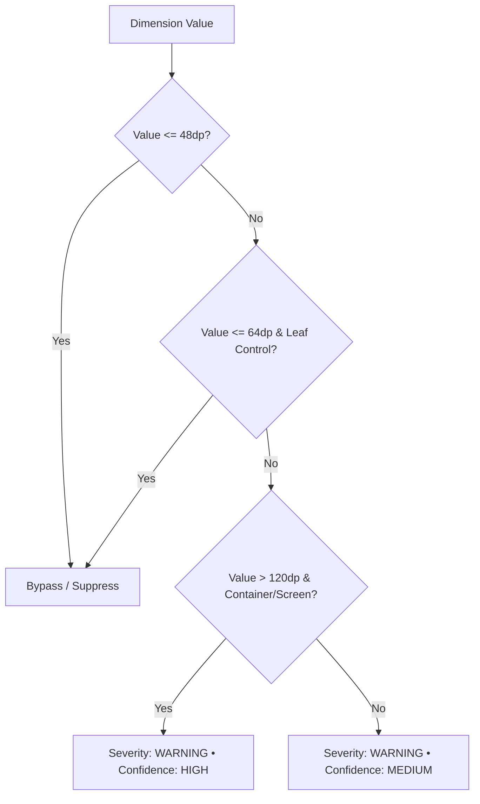

# Viewlint Static Analysis Threshold Rationales

## Executive Summary

To avoid arbitrary heuristic numbers, every threshold in Viewlint is grounded in **Android Platform Guidelines**, **Material Design 3 Specifications**, or **Android Accessibility Guidelines**.

This document documents the rationale, component scope, and axis application for all thresholds used across rules FF001–FF010.

---

## 1. Threshold Rationale Table

| Threshold | Rule Target | Targeted Axis | Applicable Component Roles | Technical Rationale & Platform Context |
| :--- | :--- | :--- | :--- | :--- |
| **$\le 48\text{dp}$** | FF007, FF008, FF010 | Width & Height | `LEAF_CONTROL`, `INPUT_SURFACE` | **Android Accessibility Guidelines**: Recommends a minimum touch target size of $48 \times 48\text{dp}$ for interactive elements (icons, badges, dividers, spacers, buttons). Sizing $\le 48\text{dp}$ is a standard accessibility design constraint, not an adaptive layout defect. |
| **$\le 64\text{dp}$** | FF007, FF010 | Width & Height | `LEAF_CONTROL` | **Material Design 3 Component Spec**: Upper bound for standard visual thumbnails, avatars, progress indicators, and chips. Visual leaf graphics without text content do not suffer from variable text clipping. |
| **$> 120\text{dp}$** | FF007 | Height | `CONTENT_CONTAINER`, `SCREEN_LAYOUT` | **Content Clipping Risk Threshold**: Fixed container heights $> 120\text{dp}$ containing multi-line dynamic text or dynamic children risk vertical text truncation when localized text expands or screen density changes, unless internal scrolling is provided. |
| **$\ge 300\text{dp}$** | FF004 | Width & Height | Non-scroll XML Views | **Compact Screen Boundary Spec**: Compact phone window widths start at $320\text{dp}$. A non-scroll inner view locking both dimensions $\ge 300\text{dp}$ risks overflowing compact or split-screen windows. |
| **Node Count $> 15$** | FF005 | XML Hierarchy | Root Layout Containers | **Layout Complexity Heuristic**: XML layouts containing $> 15$ DOM nodes represent multi-view screen layouts that benefit from tablet-qualified resource variants (`layout-sw600dp`). |

---

## 2. Confidence Matrix Across Threshold Boundaries

Confidence ratings are computed deterministically based on threshold boundaries and role evidence:

